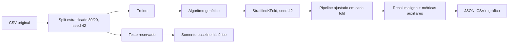

# Tech Challenge - Fase 2: otimização de modelos de câncer de mama

Continuação preservadora do projeto da Fase 1. O repositório mantém os notebooks, o CSV e as imagens originais e adiciona uma primeira versão funcional de um algoritmo genético para otimizar Regressão Logística e Árvore de Decisão.

Esta etapa reproduz os baselines, faz a busca somente no conjunto de treino e registra resultados de duas execuções pequenas. Ela **não** avalia no teste os indivíduos otimizados: essa comparação final pertence aos experimentos completos posteriores.

## O que foi preservado da Fase 1

- `cancer-regressao-logistica.ipynb`: regressão com `StandardScaler`, ajustado apenas no treino.
- `cancer-arvore-decisao.ipynb`: árvore e escolha de `max_depth=7` por CV no treino.
- `comparativo.ipynb`: comparação histórica.
- `dataset-breast-cancer/data.csv` e `img/`: dados e figuras originais.
- Divisão estratificada 80/20 com `random_state=42`.
- Codificação original do CSV: `M` (maligno) = `1`; `B` (benigno) = `0`.

Os resultados reproduzidos coincidiram com os notebooks; não foi necessário criar um baseline metodologicamente corrigido separado. Consulte [a tabela de referência](results/phase1_baseline/reference_table.md) e o [registro completo em JSON](results/phase1_baseline/baseline_metrics.json).

| Modelo | Accuracy no teste | Recall maligno | Precision maligna | F1 maligno | FN | Matriz `[[TN, FP], [FN, TP]]` |
|---|---:|---:|---:|---:|---:|---|
| Regressão Logística | 0,9649 | 0,9286 | 0,9750 | 0,9512 | 3 | `[[71, 1], [3, 39]]` |
| Árvore de Decisão (`max_depth=7`) | 0,9386 | 0,8810 | 0,9487 | 0,9136 | 5 | `[[70, 2], [5, 37]]` |

Esses números são do teste reservado. Não devem ser comparados como se fossem equivalentes ao fitness de CV das buscas.

## Instalação no Windows PowerShell

Requer Python 3.11 ou superior; esta execução foi validada com Python 3.14.6.

```powershell
py -3.14 -m venv .venv
Set-ExecutionPolicy -Scope Process Bypass
.\.venv\Scripts\Activate.ps1
python -m pip install -r requirements.txt
python -m pip install -e .
```

As versões diretas estão fixadas em `requirements.txt`. O `.venv`, caches e temporários são ignorados pelo Git.

## Comandos

Reproduzir os baselines da Fase 1:

```powershell
python scripts\reproduce_baseline.py
```

Executar os testes:

```powershell
python -m pytest
```

Executar buscas pequenas em diretórios novos (o comando se recusa a sobrescrever um diretório não vazio):

```powershell
python scripts\run_ga.py --model logistic_regression --run-id minha_logistica --population-size 8 --generations 3 --folds 5 --seed 42
python scripts\run_ga.py --model decision_tree --run-id minha_arvore --population-size 8 --generations 3 --folds 5 --seed 42
```

Também são configuráveis `--crossover-rate`, `--mutation-rate`, `--elitism` e `--tournament-size`.

## Arquitetura e proteção contra vazamento



O objeto `GeneticAlgorithm` recebe apenas `X_train` e `y_train`; sua função fitness não possui acesso nem parâmetros de teste. A padronização da regressão está dentro do `Pipeline`, sendo reajustada exclusivamente na parte de treino de cada fold. A árvore usa um passo explícito `passthrough`, pois não requer escala.

## Algoritmo genético

- População válida gerada por modelo.
- Seleção por torneio.
- Crossover uniforme por gene, sem modificar os pais.
- Mutação por gene conforme seu tipo e reparo de combinações inválidas.
- Elitismo configurável e tamanho de população constante.
- Fitness principal: recall médio da classe maligna (`pos_label=1`) em CV estratificada.
- Desempate fixo: F1 médio e depois precision média.
- Registro de dispersão, falsos negativos por fold, tempo e falhas.
- Falhas de treino ou convergência recebem resultado inválido; não ganham score favorável.

Maximizar somente recall pode favorecer previsões excessivas de malignidade. Por isso precision e F1 acompanham todas as avaliações, mas não substituem silenciosamente o objetivo durante a execução.

Os domínios e operadores estão detalhados em [docs/genetic_algorithm.md](docs/genetic_algorithm.md).

## Resultados das verificações pequenas

Configuração comum: população 8, 3 gerações, 5 folds, seed 42, crossover 0,8, mutação 0,2 e elitismo 1.

| Busca | Melhor indivíduo | Recall CV | Precision CV | F1 CV | FN somados nos folds | Falhas |
|---|---|---:|---:|---:|---:|---:|
| Logística | `C=0,3923488`, `liblinear`, `l2` | 0,95294 | 0,98269 | 0,96686 | 8 | 2 avaliações `saga/l1` sem convergência |
| Árvore | `depth=3`, `split=23`, `leaf=12`, `log_loss` | 0,90000 | 0,90537 | 0,90216 | 17 | 0 |

Artefatos completos:

- `results/ga/small_logistic_seed42/`
- `results/ga/small_tree_seed42/`
- Cada pasta contém `config.json`, `history.csv`, `history.json`, `best_individual.json`, `summary.json` e `evolution.png`.

O scikit-learn 1.9 ainda aceita o gene `penalty`, mas emite aviso de depreciação com remoção prevista para 1.10. Os avisos foram registrados; uma migração de representação deve ser feita antes de atualizar a biblioteca.

## Estrutura adicionada

```text
src/breast_cancer_ga/   carregamento, genes, fitness, GA e persistência
scripts/                reprodução do baseline e CLI das buscas
tests/                  testes unitários e integração curta
results/                métricas, históricos e gráficos verificados
docs/                   requisitos, decisões e próximos passos
```

## Checklist desta etapa

- [x] Preservar e inspecionar os artefatos da Fase 1.
- [x] Conferir o documento oficial da Fase 2 e mapear o escopo.
- [x] Criar `.venv` e fixar dependências.
- [x] Reproduzir os dois baselines e salvar JSON, CSV e tabela.
- [x] Implementar e validar genes dos dois modelos.
- [x] Implementar fitness somente no treino com CV estratificada e Pipeline.
- [x] Implementar seleção, crossover, mutação, elitismo e evolução.
- [x] Registrar configurações, métricas, falhas, históricos e gráficos.
- [x] Executar uma busca pequena por modelo.
- [x] Passar os testes automatizados.
- [ ] Executar ao menos três experimentos completos com configurações diferentes.
- [ ] Avaliar uma configuração final selecionada no teste reservado.
- [ ] Integrar e avaliar uma LLM.
- [ ] Produzir relatório técnico e vídeo de até 15 minutos.
- [ ] Decidir sobre nuvem/IaC (opcional no documento oficial).

O mapeamento completo entre o PDF, o escopo implementado e as pendências está em [docs/fase2_requirements.md](docs/fase2_requirements.md).
