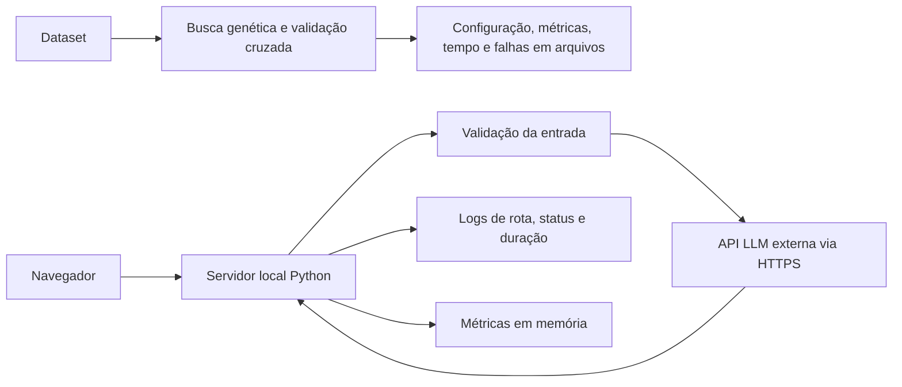

# Monitoramento e arquitetura

O projeto executa localmente a busca genética e a interface de interpretação. A busca registra suas configurações, métricas por geração, tempo e falhas nos arquivos CSV e JSON em `results/ga/`. A interface registra a atividade do serviço durante a execução.

## Acompanhamento da interface

Inicie a interface conforme o README. O terminal apresenta uma linha por requisição à página ou à interpretação, contendo horário, rota normalizada, código HTTP e duração em segundos. Requisições para `/healthz` e `/metrics` não são registradas nem contabilizadas. Os logs não incluem corpo da requisição, resposta, credenciais, endereço do cliente ou caminhos arbitrários.

Em outro terminal PowerShell, consulte `Invoke-RestMethod http://127.0.0.1:8000/healthz` para verificar se o processo responde e `Invoke-WebRequest http://127.0.0.1:8000/metrics | Select-Object -ExpandProperty Content` para ver as métricas. O endpoint de saúde não verifica a conexão ou as credenciais do provedor.

As métricas incluem requisições em andamento (`interpreter_active_requests`), total de requisições concluídas (`interpreter_requests_total`) e soma e contagem da duração (`interpreter_request_duration_seconds_sum` e `_count`), separadas por rota normalizada e status. A duração da interpretação inclui o tempo de espera pela LLM. A duração média para uma rota e status é a soma dividida pela contagem correspondente. Acompanhe erros 4xx e 5xx e o tempo de resposta para identificar problemas de entrada ou do serviço/provedor.

Os contadores ficam em memória, são reiniciados quando o processo para e não constituem armazenamento histórico ou alertas automáticos. Os logs vão para a saída do processo; preserve-os externamente se precisar de histórico. A interface é local por padrão; `/metrics` não tem autenticação. O projeto não configura escalabilidade automática, coleta contínua nem alertas. Consulte `docs/llm_interpretation.md` para as limitações da integração e privacidade.
